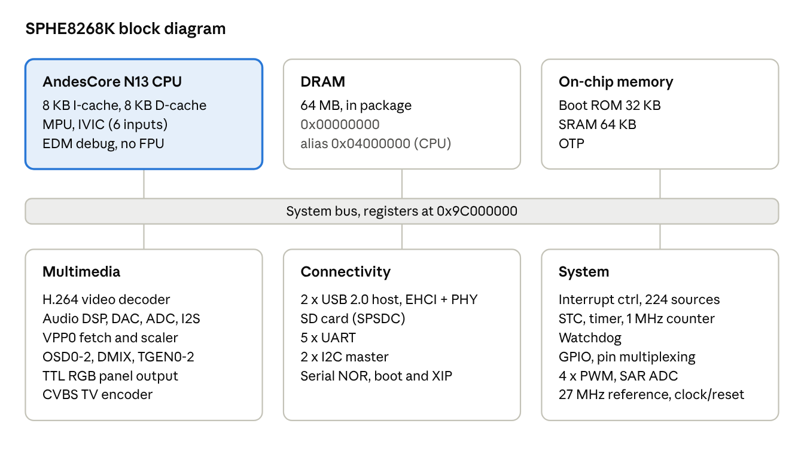

# SPHE8268K Datasheet

Revision: 2026-11-02

## 1. General description

The SPHE8268K (internal name "gemini") is a multimedia SoC built around a single AndesCore N13 (AndeStar V3) 32-bit RISC core with 64 MB of in-package DRAM. It integrates an H.264 video decoder, an audio DSP, a multi-layer display controller with a TTL RGB panel interface and a CVBS encoder, two USB 2.0 EHCI host controllers, an SD card controller, a serial NOR flash boot path and a Sunplus Plus1-family peripheral set (interrupt controller, STC timers, watchdog, UARTs, GPIO).

The register map, interrupt controller, UARTs and watchdog are layout-compatible with the Sunplus SP7021.

### 1.1 Features

**CPU**

- AndesCore N13, AndeStar V3 baseline, 16-bit ISA, performance extensions 1 and 2, string extension, DIV and MAC
- 8 KiB 2-way instruction cache and 8 KiB 2-way data cache, 32-byte lines
- Memory protection unit (8 regions of 512 MiB); no paged MMU
- Internal vectored interrupt controller (IVIC), 6 inputs
- EDM debug module, performance counters
- No FPU, no L2 cache, no ILM/DLM

**Memory**

- 64 MB DRAM, in package
- 32 KB mask boot ROM
- 64 KB on-chip SRAM
- OTP (USB PHY trim)
- Serial NOR flash interface, memory-mapped read window

**System**

- 27 MHz crystal input; 270 MHz system clock
- Interrupt controller, 224 sources, two outputs to the CPU
- STC (90 kHz system time clock), general-purpose timers, free-running 1 MHz counter
- Watchdog with chip reset
- GPIO with per-pin first-function select

**Multimedia**

- H.264 video decoder, command-ring (SPMP) driven, tiled 4:2:0 output, up to 1920 pixels wide
- Audio DSP with on-chip microcode, PCM rings in DRAM, digital gain
- Display: OSD layers (ARGB8888, RGB565, YUY2 and others), VPP video plane with scaler, display mixer (DMIX), timing generator (TGEN), TTL RGB panel output, CVBS TV encoder, PWM backlight output

**Connectivity**

- 2 × USB 2.0 host (EHCI), integrated PHYs
- SD card controller (SPSDC)
- 5 × UART

**Package**

- 128-pin QFP

### 1.2 Block diagram



## 2. CPU core

The CPU is an AndesCore N13 (CPUID 0x0D, revision 0x18), little-endian, without FPU.

### 2.1 Configuration registers

| Register | Value | Field decode |
| --- | --- | --- |
| CPU_VER | 0x0D180037 | CPUID 0x0D (N13), REV 0x18, CFGID 0x0037: PERF_EXT, 16-bit ISA, PERF_EXT2, STRING_EXT; no FPU |
| ICM_CFG | 0x000020C9 | 128 sets, 2 ways, 32-byte lines (8 KiB); no ILM, no locking |
| DCM_CFG | 0x000020C9 | 128 sets, 2 ways, 32-byte lines (8 KiB); no DLM, no locking |
| MSC_CFG | 0x1D284065 | BASEV 2 (V3), DIV, MAC, EDM, PFM; no L2C, no audio ISA, no HSMP, no trace |
| MMU_CFG | 0x4908BB05 | MMPS 1 (MPU), MMPV 1, TBW 3, TBS 7, EP8MIN4 1, EPSZ 0x08, TLBLCK 1, HPTWK 0, DE 0 (little-endian), NTPT 1, NTME 1 |
| MMU_CTL | 0x00072004 | NTC0 2, NTM1 1, NTM2 2, NTM3 3 |
| CACHE_CTL | 0x00000033 | I-cache on, D-cache on, critical-word forwarding, concurrent miss and write-back |
| IVB | 0x00000801 | IVIC_VER 1, NIVIC 0 (6 inputs), EVIC 0 (internal vectored), IVBASE 0 |
| PSW | 0x0007400A | INTL 1, superuser, IT 0, DT 0, WBNA 1, CPL 7, GIE 0 |
| INT_MASK | 0xC0000000 | no hardware inputs enabled |

Values are the state on entry from the boot loader.

### 2.2 Memory protection

The protection unit divides the 4 GiB address space into 8 regions of 512 MiB (bases 0x00000000, 0x20000000, …, 0xE0000000). Each region is written with `tlbop targetwrite`: TLB_VPN holds the region limit and TLB_DATA a physical base plus attributes. There are no page tables and no hardware page-table walker.

### 2.3 Exceptions and interrupts

IVB.IVBASE selects a 64 KiB-aligned vector base; IVB.ESZ = 1 (IVB bit 14) selects 16-byte vector entries.

| Vector | Source |
| --- | --- |
| 0 | Reset / NMI |
| 1–4 | TLB fill, PTE not present, TLB misc, VLPT miss |
| 5 | Machine error |
| 6 | Debug |
| 7 | General exception (includes `trap`) |
| 8 | System call |
| 9–14 | Hardware inputs HW0–HW5 |
| 15 | Software interrupt |

HW0 is EXT_INT0 of the interrupt controller (section 5.2). The CPU input driven by EXT_INT1 is unknown.

On a `trap`, ITYPE holds the SWID in bits 30:16, the vector number in bits 9:5 and ETYPE 2 in bits 3:0. IPC and EVA point at the trapping instruction; return to IPC + 4. The exception registers EVA, P_EVA, ITYPE, P_ITYPE, MERR, IPSW, P_IPSW, IPC, P_IPC and OIPC are implemented.

### 2.4 Cache coherency

DMA masters (video decoder, display fetch, OSD, audio DSP, USB) are not coherent with the CPU data cache. Software writes back the D-cache over a buffer before a device reads it and invalidates it before the CPU reads data a device wrote. Instruction memory written by the CPU requires a D-cache write-back and I-cache invalidate before execution.

## 3. Memory map

### 3.1 Address space

| Start | End | Size | Region |
| --- | --- | --- | --- |
| 0x00000000 | 0x03FFFFFF | 64 MB | DRAM |
| 0x04000000 | 0x07FFFFFF | 64 MB | DRAM alias (CPU) |
| 0x08000000 | 0x97FFFFFF |  | reserved; access hangs the bus |
| 0x98000000 | 0x98FFFFFF | 16 MB | serial NOR flash read window |
| 0x99000000 | 0x9BFFFFFF |  | reserved; access hangs the bus |
| 0x9C000000 | 0x9C00FFFF | 64 KB | peripheral registers |
| 0x9C100000 | 0x9C10FFFF |  | USB host controllers |
| 0x9C150000 |  |  | display panel control |
| 0x9E000000 | 0x9E007FFF | 32 KB | boot ROM |
| 0x9E008000 | 0x9E00FFFF | 32 KB | boot ROM mirror |
| 0x9E830000 | 0x9E83FFFF | 64 KB | SRAM |

The display fetch and the audio DSP address DRAM only below 0x04000000.

### 3.2 Peripheral registers

| Base | Block | Section |
| --- | --- | --- |
| 0x9C000000 | Chip ID, clock enables, resets | 5.2, 5.3 |
| 0x9C000080 | Pin multiplexing | 6.2 |
| 0x9C000180 | USB mode, panel mode | 7.3, 8.4 |
| 0x9C000200 | DSP clock, audio PLL | 9.7 |
| 0x9C000320 | GPIO OE, OUT, IN | 6.1 |
| 0x9C000600 | STC, watchdog, timer | 5.6, 5.7 |
| 0x9C000780 | Interrupt controller, group 0 | 5.5 |
| 0x9C000800 | UART2 | 7.1 |
| 0x9C000880 | UART3 | 7.1 |
| 0x9C000900 | UART0 | 7.1 |
| 0x9C000980 | UART1 | 7.1 |
| 0x9C000A80 | Interrupt controller, group 1 | 5.5 |
| 0x9C001700 | Audio DSP, codec, I2S (to 0x9C0022FF) | 9 |
| 0x9C002F00 | SAR ADC | 7.5 |
| 0x9C003100 | Reset control, boot mode | 5.4 |
| 0x9C003180 | Free-running counter | 5.6 |
| 0x9C0032E4 | GPIO_FIRST | 6.1 |
| 0x9C003E80 | SD card controller | 7.2 |
| 0x9C004A80 | USB PHY0 | 7.3 |
| 0x9C004B00 | USB PHY1 | 7.3 |
| 0x9C005780 | DDFCH | 8.5 |
| 0x9C005A80 | VPP control | 8.6 |
| 0x9C005D80 | VSCL | 8.6 |
| 0x9C006080 | VPOST | 8.1 |
| 0x9C006200 | OSD0–OSD2 | 8.2 |
| 0x9C006480 | GSCALER | 8.1 |
| 0x9C006A80 | TGEN0–TGEN2 | 8.4 |
| 0x9C006C80 | DMIX0–DMIX2 | 8.3 |
| 0x9C007280 | TV encoder | 8.1 |
| 0x9C007A00 | PWM | 7.6 |
| 0x9C008780 | UART4 | 7.1 |
| 0x9C009A00 | Picture quality | 8.8 |
| 0x9C00A380 | BG2D buffer index table | 8.7 |
| 0x9C00AF00 | OTP | 5.8 |
| 0x9C00C000 | Video decoder (to 0x9C00FFFF) | 10 |
| 0x9C102100 | EHCI0 | 7.3 |
| 0x9C104100 | EHCI1 | 7.3 |

## 4. Boot

The SoC boots from a 32 KB mask ROM at 0x9E000000 (mirrored at 0x9E008000). The ROM loads a second-stage loader (xboot) from serial NOR flash into the 64 KB on-chip SRAM at 0x9E830000; xboot initializes DRAM and loads U-Boot.

### 4.1 Boot ROM, serial NOR

| Parameter | Value |
| --- | --- |
| SPI clock | 12 MHz |
| SPI mode | 0 |
| Read command | 0x03 (READ), 3-byte address, 4-byte transfers |
| Configuration word | flash offset 0x000040, 4 bytes |
| Loader header | flash offset 0x010000, 32 bytes, magic `XBUT` (58 42 55 54) |
| Retry on bad header | every 10 ms, 787 attempts (about 15 s) |
| After last retry | one read at flash offset 0xFFE600, then halt |

Loader header: +0x00 magic `XBUT`, +0x08 body size (little-endian; the loaded image is size + 0x20 bytes).

### 4.2 Second stage (xboot)

| Item | Value |
| --- | --- |
| Execution | SRAM 0x9E830000 |
| U-Boot image | legacy uImage, magic 0x27051956, header loaded to DRAM 0x00F00000, body to 0x00F00040 |
| Maximum body size | 0x1FFFC0 bytes |
| Integrity check | when header byte 0x1E = 0x5A: header checksum = 32-bit little-endian word sum of the 64-byte header with bytes 4–7 zeroed, compared to header +4 (big-endian); data checksum = word sum of the body plus the trailing bytes as a little-endian integer, compared to header +24 (big-endian). Other values of byte 0x1E skip the check. |
| ISP update | xboot searches the SD card (and USB) for `ISP_UPDT.BIN`; a file with a valid `PART` header is booted with the U-Boot image at file offset 0x10000. Any failure falls back to NOR boot. |
| Forced ISP | the value 0x54524151 (`QART`) in 0x9C00317C before a reset selects SD ISP boot |
| Monitor | xboot contains a monitor (`XB>` prompt); its entry condition is unknown |

On a NOR boot xboot does not configure the SD card pins. Software that accesses the card after a NOR boot first applies the SD pin setup (masked writes):

| Address | Value |
| --- | --- |
| 0x9C00008C | 0x00F00050 |
| 0x9C000100 | 0x00FC00FC |
| 0x9C00010C | 0x00FC00FC |

### 4.3 State at boot loader exit

- Interrupts disabled (PSW.GIE = 0, INT_MASK = 0xC0000000), IVB.IVBASE = 0; the interrupt controller and STC timer are unprogrammed.
- STC_CFG (0x9C00061C) = 0; STC divisor 0x9C00060C = 0x8095.
- The 1 MHz counter at 0x9C003180 is running.
- OSD0 scans out a 1024 × 600 ARGB8888 frame; display backlight PWM is enabled.
- Address translation off (PSW.IT = PSW.DT = 0).

## 5. System control

### 5.1 Register conventions

Peripheral registers are grouped in 32-word (128-byte) groups: group n is at 0x9C000000 + n × 0x80. Clock, reset, pin-multiplexing and GPIO output registers are masked-write: bits 31:16 are a write enable for bits 15:0, so a single write sets or clears individual bits without a read-modify-write.

Reading an unclocked or unimplemented register group stalls the bus. Groups 0x9C000280, 0x9C000500, 0x9C000C00, 0x9C000D80, 0x9C000E80 and 0x9C006380 do not respond.

### 5.2 Chip identification

| Address | Value | Description |
| --- | --- | --- |
| 0x9C000000 | 0x00000651 | Chip ID. 0x00000650 identifies the earlier variant (affects DSP clock select and DSP release value, section 9). |

### 5.3 Clocks

| Clock | Frequency | Derivation |
| --- | --- | --- |
| Reference | 27 MHz | crystal |
| System clock | 270 MHz |  |
| Timer input | 13.5 MHz | 27 MHz / (2 × (STC_CFG[7:0] + 1)), STC_CFG = 0 |
| Free-running counter | 1 MHz | system clock / (0x9C00318C + 1), register = 0x10D |
| Watchdog count | 80 kHz |  |
| Audio DSP | 432 MHz | 0x9C000214[7:4] = 2 |
| CPU core | unknown |  |

Clock enables and resets are indexed by clock ID: word = ID >> 4, bit = ID & 15.

| Register | Address | Write |
| --- | --- | --- |
| Clock enable | 0x9C000004 + 4 × (ID >> 4) | enable: bit \| bit << 16; disable: bit << 16 |
| Reset | 0x9C000054 + 4 × (ID >> 4) | assert: bit \| bit << 16; release: bit << 16 |

After boot all clock enable words 0x9C000004–0x9C000028 read 0x0000FFFF and no reset is asserted.

| ID | Clock / reset |
| --- | --- |
| 0x00 | System reset (0x9C000054 = 0x00010001 resets the chip) |
| 0x1F, 0x21, 0x63, 0x64, 0x66–0x69, 0x6B, 0x6C, 0x6F–0x71 | Video decoder cluster resets |
| 0x5A, 0x64, 0x66, 0x69, 0x71 | Video decoder clocks |
| 0x5B | Panel clock |

Decoder cluster reset: assert with 0x9C000058 = 0x80008000, 0x9C00006C = 0x9BD89BD8, 0x9C000070 = 0x00030003; release by writing the upper halves alone.

USB PHY resets are in 0x9C00005C bits 9:8 and 7:6 (section 7.3).

### 5.4 Reset and boot mode

| Address | Description |
| --- | --- |
| 0x9C000054 | write 0x00010001: chip reset |
| 0x9C003104 | bit 5 set before a software reset |
| 0x9C00317C | boot mode, retained across reset: 0 = normal, 0x54524151 = SD ISP |
| 0x9C0000F4 | bits 1 and 4: route watchdog expiry to chip reset (masked write 0x00120012) |

Software reset sequence: 0x9C003104 |= 0x20; write the boot mode to 0x9C00317C; wait 100 µs; 0x9C000054 = 0x00010001.

### 5.5 Interrupt controller

The interrupt controller collects 224 sources into two outputs, EXT_INT0 (CPU input HW0, vector 9) and EXT_INT1. Each bank is 7 words; source n is word n / 32, bit n % 32.

| Address | Name | Description |
| --- | --- | --- |
| 0x9C000780 | TYPE | 1 = edge, 0 = level |
| 0x9C00079C | POLARITY | 1 = active low / falling edge |
| 0x9C0007B8 | PRIORITY | 1 = EXT_INT0, 0 = EXT_INT1 |
| 0x9C0007D4 | MASK | 1 = enabled |
| 0x9C000A80 | CLEAR | write 1 to acknowledge (follow with `msync all`) |
| 0x9C000A9C | MASKED_EXT1 | pending and enabled, EXT_INT1 |
| 0x9C000AB8 | MASKED_EXT0 | pending and enabled, EXT_INT0 |
| 0x9C000AFC | GROUP | [6:0] EXT_INT1 pending words, [14:8] EXT_INT0 pending words |

State after boot: TYPE = 00000000 103FFFF3 00008000 000003FD 0000FFF8 0000005F 00000000 (words 0–6), POLARITY = 0, PRIORITY = all 1, MASK = 0.

| IRQ | Source |
| --- | --- |
| 131 (0x83) | Timer 0x9C000640 |
| 162 (0xA2) | Video decoder |
| 164 (0xA4) | MJPEG decoder |

Interrupt numbers of the UART, SD, USB and audio blocks are unknown.

### 5.6 Timers

**STC**

| Address | Name | Description |
| --- | --- | --- |
| 0x9C00060C | STC divisor | 0x8095 after boot |
| 0x9C00061C | STC_CFG | [7:0] timer input divider: f = 27 MHz / (2 × (n + 1)) |

**Timer (0x9C000640, IRQ 131)**

| Offset | Name | Description |
| --- | --- | --- |
| 0x00 | CTRL | 0 = stopped; 0xF = run, auto-reload, interrupt on expiry |
| 0x04 | PRESCALE | prescale − 1 |
| 0x08 | RELOAD | period − 1 |
| 0x0C | COUNT | 16-bit down-counter |

The timer reloads automatically; the interrupt is acknowledged in the interrupt controller only. Example: PRESCALE = 99, RELOAD = 1349 gives 100 Hz from 13.5 MHz.

**Free-running counter (0x9C003180)**

32-bit up-counter at 1 MHz.

| Address | Description |
| --- | --- |
| 0x9C00318C | prescaler; 0x10D for 1 MHz |
| 0x9C0031E8 | write 0x1234 to latch the count |
| 0x9C0031E0 | latched count [15:0] |
| 0x9C0031E4 | latched count [31:16] |

### 5.7 Watchdog

| Address | Name | Description |
| --- | --- | --- |
| 0x9C000630 | WDT_CTRL | command: 0x3877 stop, 0xAB00 unlock, 0xAB01 lock, 0x7482 clear expiry, 0x4A4B resume |
| 0x9C000634 | WDT_CNT | count bits 19:4 of a 20-bit down-counter (maximum 0xFFFF, about 13 s); write while unlocked |

Expiry resets the chip only when routed through 0x9C0000F4 (section 5.4); unrouted, the expiry stays latched and enabling the routing afterwards resets the chip immediately.

Arm: stop, unlock, write WDT_CNT, lock, clear expiry, enable routing, resume. Service: unlock, write WDT_CNT, lock.

USB devices keep their VBUS supply across a watchdog reset.

### 5.8 OTP

| Address | Bits | Content |
| --- | --- | --- |
| 0x9C00AF08 | 0 | USB PHY0 RX clock invert |
| 0x9C00AF08 | 1 | USB PHY1 RX clock invert |
| 0x9C00AF18 | 4:0 | USB PHY0 disconnect level |
| 0x9C00AF18 | 12:8 | USB PHY1 disconnect level |

## 6. GPIO and pin multiplexing

### 6.1 GPIO registers

| Register | Address for GPIO n | Bit | Access |
| --- | --- | --- | --- |
| OE | 0x9C000320 + 4 × (n / 16) | n % 16 | masked write; 1 = output |
| OUT | 0x9C000340 + 4 × (n / 16) | n % 16 | masked write |
| IN | 0x9C000360 + 4 × (n / 32) | n % 32 | read only; reflects the pad whether or not GPIO owns it |
| GPIO_FIRST | 0x9C0032E4 + 4 × (n / 32) | n % 32 | read-modify-write; 1 = pad owned by GPIO |

Open-drain operation: hold OUT = 0 and switch OE (1 = drive low, 0 = release).

### 6.2 Pin multiplexing

Pin-multiplexing registers are masked-write. Field-level assignments are known only for the settings below.

| Function | Register writes |
| --- | --- |
| UART1 | 0x9C0000A4 = 0x1FE00220 |
| SD card | 0x9C00008C = 0x00F00050; 0x9C000100 = 0x00FC00FC; 0x9C00010C = 0x00FC00FC |
| TTL panel | 0x9C000100, 0x9C00010C (alternative panel modes: 0x9C000104, 0x9C000110) |
| Boot device SPI NOR | 0x9C000084 = 0x60002000; 0x9C000088 = 0x00030001 |
| Display PWM0 | DISP_PWM0 function |

Other named pin functions: AUD_EXT_DAC_IFX0–3, AUD_EXT_ADC_IFX0, AUD_BT_IFX. Their register fields are unknown.

### 6.3 Pin usage

The package pinout is unknown. GPIO numbers with an established function:

| GPIO | Function |
| --- | --- |
| 13 | output, must be high for audio output |
| 26 | illumination (headlight) input, active low |
| 86 | backlight enable output |
| 90 | touch controller reset |
| 91 | touch I2C SDA (GPIO) |
| 92 | touch I2C SCL (GPIO) |
| 93 | touch controller interrupt |

## 7. Peripheral interfaces

### 7.1 UART

Five UARTs. Register layout: +0x00 DATA, +0x04 LSR ([0] TX FIFO not full, [1] RX data available).

| UART | Base |
| --- | --- |
| UART0 | 0x9C000900 |
| UART1 | 0x9C000980 |
| UART2 | 0x9C000800 |
| UART3 | 0x9C000880 |
| UART4 | 0x9C008780 |

UART1 operates at 9600 to 460800 baud.

### 7.2 SD card controller (SPSDC)

Base 0x9C003E80. Single-block PIO transfers with hardware CRC and timeout detection.

| Offset | Description |
| --- | --- |
| 0x000 | media type: 6 = SD, 7 = MS |
| 0x0B0 | [0] cleared before each command |
| 0x0B4 | block count − 1 |
| 0x0B8 | config: [0] PIO, [2] single block, [5:4] data direction (1 write, 2 read), [8:6] response type (7 = R1 with CRC) |
| 0x0C0 | write 7 for error recovery |
| 0x0C4 | [11:0] clock divider, [12] 4-bit bus, [13] 136-bit response |
| 0x0C8 | [0] start command |
| 0x0CC | status: [1] response ready, [2] TX FIFO empty, [3] RX FIFO full, [5] DAT0 high, [6] response timeout, [7], [8] data timeout, [9] CRC7 error, [10] CRC token error, [11] CRC16 error |
| 0x0D0 | state: [13] error, [14] finished |
| 0x0D4 | block size − 1 |
| 0x0E4 | PIO TX data, 16 bits per access |
| 0x0E8 | PIO RX data, 16 bits per access, low byte first |
| 0x0EC | command index \| 0x40 (8-bit) |
| 0x0F0–0x0FC | argument bytes, MSB first, one byte per word |
| 0x100 | response: command index and bits 39:16 |
| 0x104 | response [15:0] |
| 0x204 | data command: 0x12 read, 0x21 write |
| 0x20C | recovery: write 6, wait for [2] = 0 |
| 0x210 | recovery: write 0, 1, 0 |

Single-block command:

1. Write command index and argument; clear 0x0B0[0].
2. 0x0B8 = (0x0B8 & \~0x1F0) | 0x1C0; clear 0x0C4[13].
3. Data commands: 0x0B4 = 0, 0x0D4 = 511, set 0x0B8[5:4] and 0x204, then 0x0B8 |= 5.
4. Set 0x0C8[0].
5. Transfer 256 halfwords, gated on 0x0CC[3] (read) or 0x0CC[2] (write).
6. Wait for 0x0CC[1]; read the response. R1 = (0x100 << 8) | (0x104[15:0] >> 8).
7. Wait for 0x0D0[14]; 0x0D0[13] indicates an error.
8. After a write, poll 0x0CC[5] until the card is no longer busy.

Error recovery: 0x0C0 = 7; 0x20C = 6 and wait for bit 2 to clear; 0x210 = 0, 1, 0.

A block must complete within the controller timeouts once started; a stalled FIFO causes the controller to abort the transfer.

### 7.3 USB

Two USB 2.0 high-speed host ports, each an EHCI 1.10 controller with one root port and an integrated PHY.

| Block | Base |
| --- | --- |
| EHCI0 capability / operational | 0x9C102100 / 0x9C102120 |
| EHCI1 capability / operational | 0x9C104100 / 0x9C104120 |
| PHY0 | 0x9C004A80 |
| PHY1 | 0x9C004B00 |

| Parameter | Value |
| --- | --- |
| HCIVERSION | 0x0110 |
| CAPLENGTH | 0x20 |
| HCSPARAMS | 0x00001101 (N_PORTS 1, PPC 0, N_PCC 1, N_CC 1) |
| Descriptor formats | standard EHCI qTD (32 bytes) and QH |

PHY initialization:

1. 0x9C00005C = 0x03000300, wait 1 ms; 0x9C00005C = 0x03000000, wait 1 ms.
2. 0x9C004AF0 = 0x87474002; 0x9C004B70 = 0x87474004.
3. 0x9C004AF8 and 0x9C004B78: 0x88, 0x80, 0x88, 0x80 (1 ms after each), then 0x00; wait 20 ms.
4. 0x9C00005C = 0x00C000C0, wait 1 ms; 0x9C00005C = 0x00C00000, wait 1 ms.
5. 0x9C004ACC |= 0xF; 0x9C004B4C |= 0xF.
6. Disconnect level from OTP 0x9C00AF18: c = [4:0] (PHY0) or [12:8] (PHY1); value = (1 ≤ c ≤ 30) ? (c < 12 ? c + 2 : c) : 13; write to 0x9C004A9C[4:0] (PHY0) or 0x9C004B1C[4:0] (PHY1).
7. If OTP 0x9C00AF08[0]: 0x9C004AF4 |= 0x40. If 0x9C00AF08[1]: 0x9C004B74 |= 0x40.
8. Host mode: 0x9C00018C = 0x00070007.

Controller start: clear USBCMD.RS and wait for HCHalted; set HCRESET and wait for it to clear; USBCMD = (USBCMD & \~0xB2) | 1; CONFIGFLAG = 1; wait 5 ms. Port reset: hold PORTSC.PR 50 ms.

### 7.4 Serial NOR flash

| Parameter | Value |
| --- | --- |
| Read window | 0x98000000–0x98FFFFFF, cached; address = 0x98000000 + flash offset |
| Boot ROM access | 12 MHz, mode 0, command 0x03 |
| Erase block | 64 KB |
| Controller registers | unknown |

Data read through the cached window is stale after a program or erase until the corresponding cache lines are invalidated.

### 7.5 SAR ADC

Base 0x9C002F00. 12-bit result.

| Offset | Description |
| --- | --- |
| 0x04 | [8] enable |
| 0x08 | [5:4] set at initialization |
| 0x2C | [5:3] channel, [2] start |
| 0x34 | [11:0] conversion result |

Conversion: clear 0x2C[2], set the channel, set 0x2C[2], read 0x34.

### 7.6 PWM

Base 0x9C007A00. Four channels.

| Offset | Description |
| --- | --- |
| 0x04 | [3:0] channel enable, [11:8] |
| 0x08, 0x0C, 0x10, 0x14 | PWM0–PWM3 duty |

### 7.7 I2C

Two I2C master controllers (I2CM0, I2CM1). Base addresses and registers are unknown.

## 8. Display subsystem

The display subsystem fetches up to one video plane (VPP0) and three graphics planes (OSD0–OSD2) from DRAM, mixes them in a layer mixer (DMIX) and drives a parallel TTL RGB panel through a timing generator (TGEN). A second and third timing generator serve the CVBS encoder and an internal path.

### 8.1 Blocks

| Block | Base | Function |
| --- | --- | --- |
| DDFCH | 0x9C005780 | VPP0 data fetch (two AXI master ports, MA0 and MA1) |
| VPP control | 0x9C005A80 | commit, fetch size |
| VSCL | 0x9C005D80 | video scaler |
| VPOST | 0x9C006080 | video post-processing, background |
| OSD0, OSD1, OSD2 | 0x9C006200, 0x9C006280, 0x9C006300 | graphics planes |
| GSCALER | 0x9C006480 | OSD scaler |
| TGEN0, TGEN1, TGEN2 | 0x9C006A80, 0x9C006B00, 0x9C006B80 | timing: panel, CVBS (858 × 525), internal |
| DMIX0, DMIX1, DMIX2 | 0x9C006C80, 0x9C006D00, 0x9C006D80 | layer mixers |
| TV encoder | 0x9C007280 | CVBS |
| PWM | 0x9C007A00 | backlight PWM (section 7.6) |
| PQ | 0x9C009A00–0x9C009C00 | picture quality |
| BG2D | 0x9C00A380 | buffer index table, shared with the video decoder |

### 8.2 OSD planes

Each OSD plane scans a linked list of 128-byte region headers in DRAM.

| Offset | Name | Description |
| --- | --- | --- |
| 0x00 | CTRL | 0x437 in operation |
| 0x04 | EN | 1 = scan the region list |
| 0x08 | LINK_ADDR | address of the first region header |
| 0x20 | REQ_CTRL | 0x8020 in operation |
| 0x38 | CRC | per-frame checksum of fetched pixels; 0 when disabled |
| 0x40, 0x44 | HVLD_OFFSET, HVLD_WIDTH | horizontal valid window (width a multiple of 4) |
| 0x48, 0x4C | VVLD_OFFSET, VVLD_HEIGHT | vertical valid window |
| 0x50 | DATA_FETCH_CTRL | 0 |
| 0x54 | BIST_CTRL | [7] pattern generator enable, [n:8] pattern |

Region header (big-endian fields, 128-byte aligned):

| Byte | Field | Description |
| --- | --- | --- |
| 0x00 | format | color format code |
| 0x04–0x05 | V_SIZE | height, lines |
| 0x06–0x07 | H_SIZE | width, pixels, multiple of 4 |
| 0x08–0x09 | START_ROW | screen row |
| 0x0A–0x0B | START_COL | screen column |
| 0x15 |  | 7 for ARGB8888, 4 for YUY2 |
| 0x16–0x17 | STRIDE | line pitch, pixels |
| 0x18–0x1B | LINK_NEXT | next header; 0xFFFFFFE0 ends the list |
| 0x1C–0x1F | DATA_START | pixel data address |
| other |  | 0 |

A write to DATA_START in a live header takes effect at the next frame.

| Code | Format | Memory layout |
| --- | --- | --- |
| 0x0E | ARGB8888 | 32-bit little-endian word 0xAARRGGBB (bytes B, G, R, A) |
| 0x04 | YUY2 | 32-bit little-endian word Y0 \| Cb << 8 \| Y1 << 16 \| Cr << 24 |
| 0x02 (with byte 0 bit 7 set) | 8 bpp CLUT |  |

### 8.3 Layer mixer (DMIX)

| Offset | Description |
| --- | --- |
| 0x00 | [6:4] background source, [10:8] layer 1 source, [14:12] layer 2 source |
| 0x04 | layer mode, 2 bits per layer (field 0 = layer 1, field 1 = layer 2): 0 = alpha blend, 1 = transparent, 2 = opaque |
| 0x08 | 3-bit source fields for layers 3, 4 |
| 0x1C | output checksum |
| 0x2C, 0x30, 0x34 | background Y, Cb, Cr (8-bit) |
| 0x68 | [5:4] output select |

Source codes: 0 = VPP0, 3 = OSD0, 7 = pattern generator. Layer 2 is above layer 1. An enabled opaque layer with no input data shows YCbCr (0, 0, 0).

### 8.4 Timing generator (TGEN)

Register n is at offset 4n.

| Reg | Name | Description |
| --- | --- | --- |
| 0 | CONFIG |  |
| 1 | RESET | [0] timing reset, pulsed after programming |
| 4 | USER_MODE | [0] user timing mode |
| 7 | VENC_RESET_LINE |  |
| 8 | TOTAL_PIXEL |  |
| 9 | ACTIVE_PIXEL |  |
| 10 | TOTAL_LINE |  |
| 11 | LINE_END |  |
| 12 | ACTIVE_START_LINE |  |
| 13 | LINE_COUNT | [11:0] current line, [12] field |
| 23–27 | ADJUST | two 6-bit fields per register ([5:0], [13:8]) for inputs 0–9; VPP0 = reg 23 [13:8] |
| 29 | SOURCE_SEL | 2 bits per input: field k at [2k+1:2k] for k = 0–6, field 7 at [17:16], field 8 at [15:14]; VPP0 = field 0, OSD0–2 = fields 3–5; value = TGEN number |

Panel timing (TGEN0):

| Parameter | Horizontal (pixels) | Vertical (lines) |
| --- | --- | --- |
| Total | 1344 | 635 |
| Active | 1024 | 600 |
| Front porch | 120 | 5 |
| Sync | 40 | 7 |
| Back porch | 160 | 23 |

Register values: TOTAL_PIXEL 0x540, ACTIVE_PIXEL 0x400, TOTAL_LINE 0x27B, LINE_END 0x277, ACTIVE_START_LINE 0x1E.

Panel interface: parallel TTL RGB. Panel clock enable: 0x9C000018 = 0x08000800 (clock ID 0x5B). Panel mode: 0x9C150098[26:24] and 0x9C0001AC = 0x07000000 | mode << 4.

### 8.5 VPP0 data fetch (DDFCH)

| Address | Description |
| --- | --- |
| 0x9C005780 | latch enable: 1 = latched |
| 0x9C005784 | mode: [20] 1 = BG2D index addressing, 0 = physical; [17], [18] luma, chroma on MA1 |
| 0x9C005788 | [4] fetch enable; [6], [7] set in operation (0xF8 running) |
| 0x9C005790 | 0xEF in operation; 0 stops all reads |
| 0x9C005798–0x9C0057A0 | luma base, slots 0–2: phys >> 10, or BG2D index |
| 0x9C0057A4–0x9C0057AC | chroma base, slots 0–2 |
| 0x9C0057BC | frame slot select (0x14) |
| 0x9C0057D0 | physical mode: line pitch, bytes; index mode: ALIGN128(width) |
| 0x9C0057D4 | crop size: height [27:16], width [12:0] |
| 0x9C0057D8 | crop offset: y [27:16], x [12:0] |
| 0x9C0057DC | 0x10011 |
| 0x9C0057E8 | [15:0] checksum, nonzero while fetching |
| 0x9C0057EC | errors: [5] incomplete frame, [8] luma line buffer empty, [9], [10] burst count MA0, MA1; [13:12], [17:16] AXI response MA0, MA1 (2 = SLVERR, 3 = DECERR) |
| 0x9C0057F0 | BIST: [0] enable, [5:4] 1 = color bar, 2 = solid; 0x80801011 = color bar, 0x80801020 = off |

Maximum fetch width: 1024. DDFCH reads through the BG2D unit in both addressing modes; BG2D must be initialized before the first fetch. An AXI error locks DDFCH until a chip reset.

### 8.6 VPP control and scaler

| Address | Description |
| --- | --- |
| 0x9C005A80 | [0] commit (applied at next frame), [1] block on; 0x203 in operation |
| 0x9C005ACC | fetch width |
| 0x9C005AF0 | fetch height |
| 0x9C005D80 | VSCL enable (1) |
| 0x9C005D84 | [2] H scaling, [3], [4] V scaling, [7] color bar, [9] 0 = progressive; 0x5F in operation |
| 0x9C005D8C, 0x9C005D90 | input width, height |
| 0x9C005D94–0x9C005DA0 | crop x, y, width, height |
| 0x9C005DA4, 0x9C005DA8 | panel width, height |
| 0x9C005DAC–0x9C005DB8 | output x, y, width, height |
| 0x9C005DC8 | [7:4] horizontal filter |
| 0x9C005DCC, 0x9C005DD0 | horizontal factor [15:0], [24:16] |
| 0x9C005E00 | [7:4] vertical filter |
| 0x9C005E04, 0x9C005E08 | vertical factor low, high |
| 0x9C005E58 | checksum |

Scale factor = ((in − 1) << 22) / (out − 1). Examples: 800 → 1024 = 0x31FC7F; 480 → 600 = 0x332DBA.

### 8.7 BG2D buffer index table

| Address | Description |
| --- | --- |
| 0x9C00A380 | bytes 0–3: pitch slots 0–3, pitch / 16 |
| 0x9C00A384–0x9C00A3B8 | layout tables (initialization values below) |
| 0x9C00A39C | control: [4], [5], [13] |
| 0x9C00A400 + 4i | entry i (0–255): [18:0] phys >> 10, [20:19] pitch slot, [26:21] layout |

Layout values: 0x07000000 (type 1, read by VPP0 index mode), 0x05400000 (type 0). Initialization:

1. 0x9C00A39C &= \~0x20.
2. 0x9C00A384–0x9C00A398 = 0x83828100, 0x05048584, 0x00808604, 0x82818000, 0x05858483, 0x00208604.
3. 0x9C00A3A0–0x9C00A3B4 = 0x83828100, 0x06050484, 0x00808504, 0x82818000, 0x06058483, 0x00208504.
4. 0x9C00A3B8 = 0x0A000A00.
5. All entries = 0x07000000.
6. 0x9C00A39C |= 0x2000, then |= 0x10.

### 8.8 VPP0 programming sequence

1. Initialize BG2D (8.7).
2. VPOST: 0x9C006080[5:0] = 0x11; 0x9C0060A4[1:0] = 0; 0x9C0060A8 = 0x10; bytes 0x9C0060AC, 0x9C0060AD = 0x80.
3. 0x9C006F80 = 1; 0x9C006F84 = 0; 0x9C006FC8 = 0x7F; 0x9C007000[0] = 1, [12] = 0; 0x9C007004 = 0x3FF.
4. PQ: 0x9C009A00[2:0] = 3; 0x9C009A04[8] = [0] = 0; 0x9C009B00[0] = 1, [2] = 0, [4] = 1; 0x9C009B80[0] = 1, [4] = 0, [5] = 1; 0x9C009C00[0] = [2] = 1.
5. VPP control: 0x9C005A80 [0], [1], [8] set, [6], [13:9] clear; 0x9C005B34–0x9C005B50 = 0x1807, 0x6F0, 0x8FE, 0x4555, 0xA, 0x5014, 0xFF0C, 3.
6. VSCL: enable, geometry, factors and filters (8.6); 0x9C005D84 = 0x5F.
7. Fetch size: 0x9C005ACC = width, 0x9C005AF0 = height.
8. DDFCH: 0x780 = 1; 0x784 = 0x15E000 (index) or 0x5E000 (physical); 0x78C = 0xD6D6D6; 0x790 = 0xEF; luma and chroma slots; 0x7B0, 0x7B4, 0x7B8 |= 0x10001; 0x7BC = 0x14; 0x7D0, 0x7D4, 0x7D8 geometry; 0x7DC = 0x10011; 0x7E4 = 0x10; 0x7F0 = 0x80801020; 0x788 = 0xF8.
9. Index mode: 0x9C00A382 = pitch / 16; BG2D entries for luma and chroma = phys >> 10 | 2 << 19 | 0x07000000.
10. DMIX: layer 1 mode = 2 (opaque); layer 2 (OSD0) mode = 0 (blend) or 1 (hidden).
11. Commit: 0x9C005A80 = 0x203.

Per frame: update the luma and chroma BG2D entries, then set 0x9C005A80[0].

In index mode the display reads decoder output in tile layout type 1 (section 10.6).

### 8.9 Backlight

PWM0 (section 7.6) is routed to the DISP_PWM0 pin; GPIO86 is the backlight enable.

## 9. Audio subsystem

The audio subsystem is a programmable DSP that runs microcode from a DRAM window assigned by the CPU, an internal stereo DAC/codec at 48 kHz, two ADC input multiplexers, and an I2S port. Registers occupy 0x9C001700–0x9C0022FF; offsets below are from 0x9C000000.

| Parameter | Value |
| --- | --- |
| DSP clock | 432 MHz (chip ID 0x651), 308 MHz (chip ID 0x650) |
| Code banks | 6, plus one data memory |
| Output sample rate | 48 kHz |
| Shared memory byte order | big-endian 16-bit halfwords |
| Addressable range | physical 0x00000000–0x0FFFFFFF (28-bit fields); DRAM below 0x04000000 |
| Interrupt | unknown; all handshakes are polled |

Reading 0x9C001B00–0x9C001DFF while the DSP runs hangs the system.

### 9.1 DSP control and mailbox registers

| Offset | Name | Description |
| --- | --- | --- |
| 0x1744 + 4b (b = 0–5) | BANKb_ADDR | [27:0] bank base = (phys & 0x0FFFFFFF) >> 8; [28:24] loaded codec ID; [31] loaded |
| 0x1764 | DATA_BASE | data memory byte address & 0x0FFFFFFF |
| 0x1780 | DSP_RUN | write 1: hold DSP; write 0x10 (ID 0x651) or 0 (ID 0x650): release |
| 0x1784 | DOORBELL | [0] CPU sets to post a command; must read 0 before posting |
| 0x1790 | BUSY_A | pre-hold poll: wait while (BUSY_A >> 1) ≠ 0 and BUSY_B[15:0] ≠ 0 |
| 0x1794 | DSP_CFG | [1] set when codec 0 header flag bit 0 is clear |
| 0x1798 | DSP_STOP | write 2 before hold; reads 0 |
| 0x17C0–0x17D4 | BANKb_SIZE | bank 0–5 size in bytes |
| 0x17E0 | DATA_SIZE | window size minus (DATA_BASE − bank 0 base) |
| 0x1824 | BUSY_B | [15:0] second pre-hold poll term |
| 0x1880 | CMD | [31] done (set by DSP); [30:24] command; [23:16] P1; [15:0] P2 |
| 0x1884 | CMD_ARG | P3, 32 bits |
| 0x1888–0x18E4 | ring pointers | section 9.6 |
| 0x18A8 | D2C_MSG | [31] 0 = DSP message pending (CPU writes 1 to acknowledge); [29:28] 0 = payload in [15:0], 2 = payload in D2C_EXT |
| 0x18AC | D2C_EXT | extended message payload |
| 0x18B0 | DSP_STATE | module state nibbles (9.2) |
| 0x18B4 | HEARTBEAT | [15:0] changes continuously while the DSP runs |
| 0x1ED0 | DATA_BASE copy | DATA_BASE & 0x0FFFFFFF |

Mailbox clear: write 0 to the 31 words from 0x1880, then 0x80000000 to 0x1880, 0x18A8 and 0x18F8.

### 9.2 DSP state word (0x18B0)

| Bits | Module | States |
| --- | --- | --- |
| 3:0 | System | 0 init, 1 ready, 2 idle, 3 run, 4 dead |
| 7:4 | Stream 1 | 0 init, 1 ready, 2 stop, 3 play, 4 fast-forward, 5 pause |
| 11:8 | Stream 2 | as stream 1 |
| 15:12 | Hands-free decoder |  |
| 19:16 | Encoder 1 |  |
| 23:20 | Encoder 2 |  |
| 27:24 | Hands-free encoder |  |
| 29:28 | Front output | 0 init, 1 stop, 2 play, 3 pause |

### 9.3 Commands

To post: require DOORBELL[0] = 0 and CMD[31] = 1; write CMD_ARG = P3; write CMD = cmd << 24 | P1 << 16 | P2; set DOORBELL[0]; poll CMD[31] (up to 1000 polls), servicing D2C_MSG on every poll.

| Cmd / P1 / P2 [P3] | Function |
| --- | --- |
| 0 / 0 / 2, 0 / 0 / 3 | system idle, system run |
| 0 / m / 2, 3, 5 | module m stop, play, pause; 0 / 7 / 1 and 0 / 7 / 2 = front output stop and play |
| 1 / 0 / 0 [mask] | module enable mask (boot value 0x001F4FEF) |
| 1 / 3 / 0 [x] | acknowledge DSP event word |
| 3 / 2–4 / v | media 1–3 configuration |
| 3 / 0xA / 0 [step] | decoder ramp, step = 0x8000 / (ms × fs / 1000) |
| 3 / 8 / 1 | front output enable (before front play) |
| 5 / 2 | RISC parameter block changed |
| 5 / 3 / idx [val] | single RISC parameter changed |
| 5 / 4 | RiscApp parameter block changed |
| 6 / 3 / x, 6 / 4 / x | mute, demute |
| 6 / 7 / 1, 6 / 7 / 0 | master mute, master unmute |
| 6 / 8 / 1, 2, 3 | ring 10 sample rate 48, 24, 16 kHz |
| 6 / 0xD / 0 [bits] | auxiliary mixer doorbell |

### 9.4 Microcode

Microcode images carry a 64-byte big-endian header; code follows the header, and an optional data blob immediately precedes it.

| Offset | Field |
| --- | --- |
| 0x00 | magic 0x6966 (`if`) |
| 0x02 | flags: [0] (clear → set DSP_CFG[1]), [1] data blob present |
| 0x04 | [7:0] codec ID |
| 0x08 | code size, bytes |
| 0x0C | data blob size, bytes |
| 0x14, 0x18 | code and data checksum: c = 0; for each byte b: c ^= b; c = rotl32(c, 1) |

| Codec ID | Function | Bank |
| --- | --- | --- |
| 0x00 | system | 0 |
| 0x01 | PCM decoder | 1–2 |
| 0x02, 0x06–0x0A, 0x0D, 0x13, 0x14, 0x16, 0x18, 0x1E | stream decoders | 1–2 |
| 0x1B, 0x1D |  | 3–4 |
| 0x1C |  | 5 |

### 9.5 Memory window

Banks are contiguous from the window base; each bank size is the largest codec of its class rounded up to the next 256 bytes. Data memory follows bank 5.

| Region | Offset | Size |
| --- | --- | --- |
| Bank 0 | 0x000000 | 0x33400 |
| Bank 1 | 0x033400 | 0x18100 |
| Bank 2 | 0x04B500 | 0x18100 |
| Bank 3 | 0x063600 | 0x0CF00 |
| Bank 4 | 0x070500 | 0x0CF00 |
| Bank 5 | 0x07D400 | 0x14500 |
| Data memory | 0x091900 | remainder (0x432F00 in a 0x4C4800 window) |

Data memory layout (offsets from DATA_BASE):

| Offset | Size | Content |
| --- | --- | --- |
| 0x000 | 0x180 | RISC parameters (192 halfwords); change → command 5/2 |
| 0x180 | 0x100 | RiscApp parameters (128 halfwords); change → command 5/4 |
| 0x280 | 0x200 | info table, written by the DSP; each entry × 128 = offset from DATA_BASE |
| 128 × info[0x36] | 0x500 | App area (EQ, 9.8) |
| 128 × info[0x3C] | 0x100 | Swb area |

| Info offset | Points to |
| --- | --- |
| 0x04–0x10 (step 2) | rings 1–7 |
| 0x30, 0x2E, 0x1EC, 0x1EA, 0x24 | rings 8, 10, 11, 12, 13 |
| 0x12, 0x14, 0x16, 0x1A, 0x1C, 0x18 | data blob destination for banks 0–5 |
| 0x26, 0x28 | DSP event word (high, low) |

### 9.6 PCM rings

Ring pointers are byte offsets. The CPU writes W to signal new data and writes R only to reset it to 0. fill = (W − R) mod size. On underrun the DSP stops at W.

| Ring | W | R | Size | Format |
| --- | --- | --- | --- | --- |
| 1 (stream 1) | 0x1888 | 0x188C | 0x4B000 | 16-bit stereo interleaved, little-endian, via the PCM decoder |
| 2 | 0x1890 | 0x1894 | 0x4B000 |  |
| 3 | 0x18B8 | 0x18BC | 100 KB |  |
| 4 | 0x18A0 | 0x18A4 | 100 KB |  |
| 5 | 0x18D0 | 0x18D4 |  |  |
| 6 | 0x18C0 | 0x18C4 | 100 KB |  |
| 7 | 0x1898 | 0x189C | 0x16800 |  |
| 8 | 0x18E0 | 0x18E4 | 0x16800 |  |
| 10 | 0x18C8 | 0x18CC | 0x16800 | 16-bit stereo, big-endian, no decoder; rate set by command 6/8 |

Master volume and EQ apply to stream 1; ring 10 bypasses them.

Stream 1 codec descriptor: 16 big-endian halfwords at RISC parameter byte 0xA0: [0] 1 (PCM), [1] 5, [2] channels, [3] bits per sample, [4] rate code (48 kHz = 0x10), [15] 0x20.

### 9.7 Codec, DAC and clock registers

| Address | Description |
| --- | --- |
| 0x9C000200 | DSP clock enable (masked): clear [9], [15:13]; set [12] |
| 0x9C000214 | [7:4] DSP clock: 1 = 540, 2 = 432, 3 = 360, 4 = 308 MHz (masked) |
| 0x9C000238 | audio PLL; [5:4] 0 = 48 kHz family, 1 = 44.1 kHz family |
| 0x1E14 | DAC control: [31:30] 11 = DAC on, 00 = off; [22:20] output select |
| 0x1E18, 0x1F64 | codec; [31] reset (active low) |
| 0x1E80–0x1EB8 | codec configuration block; 0x1E80 = 0xF enables |
| 0x1EC0, 0x1EC8 | audio time counter control |
| 0x1EC4 | audio time counter |
| 0x1F00–0x1F38 | sample clock dividers |
| 0x1F54 | [7:4] ADC0 input select (L, R) |
| 0x1FEC | [21:20], [17:16] ADC1 input select |
| 0x2188, 0x2194, 0x2198 | output port setup |
| 0x219C | S/PDIF output select |
| 0x21A4, 0x21AC, 0x21E0 | channel map (reset/boot 0x76543210) |
| 0x2280–0x2294 | I2S port: master/slave, 16/24/32-bit, LRCK polarity, justification, 1-bit delay |

### 9.8 Gain and equalizer

Gain code = 2 × (dB + 103.5): 0 = −103.5 dB (mute), 0xCF = 0 dB, range −103.5 to +24 dB.

| Parameter | Encoding |
| --- | --- |
| RiscApp 0x3D [7:0] | master volume, gain code |
| RiscApp 0x3E, 0x3F | balance and fader: [7:0] left gain code, [15:8] right gain code |
| RiscApp 0x3C | loudness: [1:0] center 400 / 800 / 2400 Hz, [3] enable, [12:8] boost |
| RiscApp 0x57–0x5C | per-channel delay in samples |
| RiscApp 0x6A | 0x800 when routed media starts, 0 when it stops |
| RISC 0x11 | per-source input gain, two gain codes |

EQ: six channels at App halfword bases 0x00, 0x28, 0x50, 0x78, 0xA0, 0xC8 (masks 1, 2, 4, 8, 0x10, 0x20), 20 slots each, two big-endian halfwords per slot. Writes take effect without a command.

| Word | Bits | Field |
| --- | --- | --- |
| 0 | 15:9 | gain in 0.5 dB steps, two's complement, ±12 dB |
| 0 | 8:6 | type: 3 peaking, 4 low-pass, 5 high-pass |
| 0 | 5:0 | peaking: round(32 / Q), Q 0.5–10; low/high-pass: family << 3 \| slope |
| 1 | 14:0 | center frequency, Hz (≤ 20000); 0 disables the slot |
| 1 | 15 | flag |

### 9.9 Initialization sequence

1. DSP clock: 0x9C000200 = (R & 0x0DFF) | 0x1000 | 0xFFFF0000; 0x9C000214 = (R & \~0xF0) | 0x20 | 0xFFFF0000.
2. Codec: 0x1F64 |= 0x80000000; 0x1E14 = 0x042BFF5F, |= 0x03800000, &= \~0x1F, |= 0xC0000000; 0x1F64 |= 0x1F; 0x1E18 |= 0x80000000, = 0x4F064F00; 0x1F54 = 0x4F00, |= 0x3F000000; 0x1E18 &= 0xF3FFF3FF; 0x1FEC = 0x00440000; 0x1F54 &= \~0xF0, |= 0xF0, &= 0xFFC0FFFF, |= 0x40000; 0x1E80 = 0, 0x1E84 = 0x7777, 0x1E88 = 0x300, 0x1E8C = 0x475, 0x1E90 = 0x7E33A9, 0x1E94 = 0x1E98 = 0x650200, 0x1E9C–0x1EA8 = 0x800000, 0x1EAC = 0x1111, 0x1EB0–0x1EB8 = 0, 0x1E80 = 0xF; 0x1E18 &= \~0x40004000; 0x1F58 = 0x06C60606; 0x1E18 = (R & 0xFFE0FFE0) | 0x00060006; 0x1F5C = 0x17171717; 0x1E08 = 0x1F3C = 0x4D; 0x1F40 = 0x1E10 = 0x5C; 0x1E20 = 0x5C004D; 0x21A4 = 0x21AC = 0x21E0 = 0x76543210; 0x21A8 = 0x98.
3. Hold: DSP_STOP = 2, wait, poll BUSY_A/BUSY_B, DSP_RUN = 1.
4. Program BANKb_ADDR, DATA_BASE, 0x1ED0, BANKb_SIZE and DATA_SIZE.
5. Initialize RISC and RiscApp parameters; zero the info table; clear the mailbox.
6. Set DSP_CFG[1] as required; copy codec 0x00 code into bank 0; clear the mailbox; DSP_RUN = 0x10.
7. Wait for system state 1, then idle (command 0/0/2).
8. Copy data blobs to the info-table destinations; load codecs 0x1D (bank 3) and 0x1C (bank 5); set the bank loaded bits.
9. Command 0/0/3; wait for system state 3.
10. 0x1E14 = (R & 0xFF8FFFFF) | 0x100000; program the sample clock dividers; 0x9C000238 = 0xFFFF1C80, then 0xFFFF1C84; pulse 0x1F64[31] and 0x1E18[31] low then high; 0x1EC0 = 1, 0x1EC8 = 0x10000010, 0x1EC0 = 0.
11. Command 1/0/0 [0x001F4FEF]; output port setup (0x2194 |= 2 and 0x2188 |= 0x8080, three times; 0x2198 |= 0x630000, &= \~0x840000).
12. Stream start: stop stream 1; reset ring 1 W and R; write the codec descriptor; load codec 0x01 into bank 1; command 0/1/3; wait for stream 1 state 3; route media 1 (RISC 0x11 = 0xCFCF, RISC 7 = 1, RISC 0x3D = 0x11, command 5/2); RiscApp 0x6A = 0x800, command 5/4.
13. Command 6/7/0 (master unmute); set master volume.

## 10. Video decoder

The video decoder (MFD) decodes H.264 into tiled 4:2:0 frame buffers. The CPU parses NAL, SPS, PPS and slice headers through the decoder's bit reader and supplies per-slice parameters as register-write command lists (SPMP); the macroblock layer is decoded in hardware.

| Parameter | Value |
| --- | --- |
| Register file | 0x9C00C000–0x9C00FFFF; register r at 0x9C00C000 + 4r |
| Interrupt | 162 |
| Maximum width | 1920 (120 macroblocks) |
| Frame buffers | up to 20 |
| Reference lists | 32 entries each (L0, L1) |
| Syntax elements | CAVLC, CABAC, High profile (8×8 transform, scaling lists), field and MBAFF, B slices, weighted prediction, FMO |
| Decode time, 800 × 480 P picture | 2.3 ms |
| Emulation prevention bytes | not removed by the bit reader or prefetch units; removed by software |

### 10.1 Clocks and reset

Decoder clocks: IDs 0x5A, 0x64, 0x66, 0x69, 0x71. Reset: assert 0x9C000058 = 0x80008000, 0x9C00006C = 0x9BD89BD8, 0x9C000070 = 0x00030003; release 0x9C000058 = 0x80000000, 0x9C00006C = 0x9BD80000, 0x9C000070 = 0x00030000. A reset pulse recovers a hung engine. After an SPMP hang (0x9C00D570 = 0x40 with 0x9C00D550[0] = 0) a read of 0x9C00D000 stalls the bus; reset first.

### 10.2 Registers

Addresses are 0x9C00xxxx.

**Control and status**

| Address | Description |
| --- | --- |
| D000 | control/status: write 0 = soft reset; 1 after a decode |
| D034 | 1 per picture |
| D048 | 1 per picture |
| D04C | status: 4 idle, 1 after a decode |
| D0AC | MP status (`mfd_mp_status`); if nonzero at reset, write 1 then 0 |
| D0B4 | 0xFE |
| D980 | codec select: 0 = H.264 |
| DB00–DB7C | cleared per picture |
| DC84 | [0] picture end |
| DE6C | 0x18 per picture |
| DF18 | EVB size in KB [15:0] |
| DF68 | EVB size in KB [17:16] |
| EC4C | [3] set at initialization |
| ECA0 | must be 0 before a trigger |
| EF00–EF44 | initialization constants (10.5) |

**Bit reader and bitstream prefetch (DPFU1)**

| Address | Description |
| --- | --- |
| D400 + 4n | read and consume n bits (n = 1–31); D400 = 32 bits |
| D480 + 4n | peek n bits |
| D884 | DPFU1 control: 0 stop, 1 start |
| D888 | start: ((byte offset >> 2) << 6) \| 0x20 |
| D88C | length, bytes (maximum 0x7FFFFC) |
| D894 | current position (D888 format) |
| D898 | remaining length |
| D8A0 | [1] data ready; [3:2] must be 0 before reset; write 1 then 0 = reset |
| D8A4 | ring descriptor (EVB_KB << 8) \| 0x28 |

**Slice data prefetch (DPFU2)**

| Address | Description |
| --- | --- |
| D904 | control: 0 stop, 1 start |
| D908, D90C | slice data start, length (D888, D88C format) |
| D914, D918 | position, remaining length |
| D920 | [0] error (write 1 then 0), [1] ready, [2] DRAM access in progress |
| D924 | ring descriptor (EVB_KB << 8) \| 0x28 |

**SPMP command engine and SPAR**

| Address | Description |
| --- | --- |
| D50C | 1 at initialization |
| D510 | SPAR control: 0 then 1 = start |
| D514 | SPAR status: [1:0] = 3 done; [9:2] bytes written to the ring |
| D520, D524 | num_ref_idx_l0 − 1, num_ref_idx_l1 − 1 |
| D530, D534 | luma, chroma log2 weight denominator |
| D538–D544 | SPAR result words |
| D548 | 1 at initialization and per picture |
| D54C | SPMP ring descriptor (SPMP_KB << 8) \| 0x29 |
| D550 | SPMP control (`spar_spmp_ctrl`): 0x1F8 then 0 = reset; 0 then 1 = start; [0] reads 1 when started |
| D554 | first block: (length in words << 21) \| start word |
| D558 | number of slice blocks to execute |
| D55C | blocks completed |
| D564 | 0 before start |
| D568 | SPAR output ring descriptor (SPMP_KB << 8) \| 0x29 |
| D56C | SPAR output write offset |
| D570 | [0] done (write 1 to clear); [n:6] state: 0xB = complete |

**Start-code scanner (SCS)**

| Address | Description |
| --- | --- |
| D640 | EVB write offset |
| D680, D684 | EVB base (phys >> 10), size in KB |
| D690, D694 | start-code info buffer base (phys >> 10), size in KB (2) |
| D6C4, D6C8 | length, consumed (plus source address & 0x3FF) |
| D6CC | source address >> 10 |
| D6D0 | ((length + (source & 0x3FF) + 0x3FF) >> 10) + 1 |
| D700 | 0 = reset, 0x25 = start |
| D704 | [0] busy, [2] source consumed, [3] EVB full |
| D710, D714 | start-code pattern 0x000001, mask 0xFFFFFF |

**Tables**

| Address | Content |
| --- | --- |
| C000–C0FC | inverse reference map (64 entries) |
| C100–C1FC | reference lists: 32 L0 entries, then 32 L1 entries; entry = luma index \| chroma index << 8 |
| C600, C798, C8D8 | B-slice weight and direct-mode tables |
| E800 | scaling lists (224 entries) |

### 10.3 SPMP command format

The command ring is in DRAM, addressed through BG2D index 0x29; words are big-endian. Register field = (address − 0x9C00C000) >> 2.

| Bits 31:28 | Command |
| --- | --- |
| 0x0 | write bits 15:0 to register [27:16] |
| 0x1 | write the next word to register [27:16] |
| 0x2 | write the next (bits 15:0) + 1 words to consecutive registers from [27:16] |
| 0xF | 0xF8000000: end of slice block |

### 10.4 Slice block

One block per slice, in this order:

| Command | Register | Value |
| --- | --- | --- |
| 0x1642 | D908 | slice data start (D894 after header parse) |
| 0x1643 | D90C | slice data length (D898 after header parse) |
| 0x0406 | D018 | field_pic_flag |
| 0x0407 | D01C | !bottom_field_flag |
| 0x0424 | D090 | direct_spatial_mv_pred_flag |
| 0x0408 | D020 | MbaffFrameFlag |
| 0x0405 | D014 | constrained_intra_pred_flag |
| 0x0420 | D080 | nal_ref_idc ≠ 0 |
| 0x0421 | D084 | entropy_coding_mode_flag |
| 0x0404 | D010 | chroma_qp_index_offset [5:0] \| second_chroma_qp_index_offset [11:6] |
| 0x0428 | D0A0 | SliceQPY |
| 0x0409 | D024 | slice_type % 5 |
| 0x0402 | D008 | PicWidthInMbs |
| 0x0403 | D00C | PicHeightInMbs |
| 0x0422 | D088 | first MB row |
| 0x0423 | D08C | first MB column |
| 0x0425 | D094 | num_ref_idx_l0_active − 1 |
| 0x0426 | D098 | num_ref_idx_l1_active − 1 (0xFFFF for I and P) |
| 0x0429 | D0A4 | co-located picture flags |
| 0x0460 | D180 | weighted_pred_flag |
| 0x0461 | D184 | weighted_bipred_idc |
| 0x0462 | D188 | luma_log2_weight_denom |
| 0x0463 | D18C | chroma_log2_weight_denom |
| 0x6000 | D800 | disable_deblocking_filter_idc |
| 0x6010 | D804 | slice_alpha_c0_offset_div2 << 1 |
| 0x6020 | D808 | slice_beta_offset_div2 << 1 |
| 0x140A | D028 | 0x3B << 24 \| 0x3C << 16 \| MVC index of current \| (MVC index of L1[0] << 8, B only) |
| 0x040B | D02C | luma index \| chroma index << 8 (current picture) |
| 0x0427 | D09C | cabac_init_idc |
| 0x0401 | D004 | [0] profile_idc > 99, [2:1] chroma_format_idc, [3] transform_8x8_mode_flag, [4] FMO, [15:8] slice group |
| 0x1464–0x1467 | D190–D19C | SPAR result words |
| 0x2040003F | C100–C1FC | reference lists |
| 0x2000003F | C000–C0FC | inverse map |
| 0xF8000000 |  | end of block |

High profile: 0x2A0000DF followed by 224 scaling-list words precedes the block.

### 10.5 Buffers

All buffers are addressed through BG2D (section 8.7) in 1 KB units.

| BG2D index | Buffer | Size |
| --- | --- | --- |
| 0x00–0x13 | luma, frame k | pitch × ALIGN64(height) |
| 0x14–0x27 | CbCr, frame k | pitch × ALIGN64(height) / 2 |
| 0x28 | bitstream ring (EVB) | 2500 KB |
| 0x29 | SPMP command ring | 1028 KB |
| 0x2A + k | co-located MV, frame k | ALIGN4(width MBs) × ALIGN4(height MBs) × 64 bytes |
| 0x3B, 0x3C | working buffers | 128 KB each |

Frame buffers use pitch slot 0, gp 1; EVB, SPMP and working buffers gp 0.

Bitstream rules: emulation prevention bytes removed; each slice NAL starts at a word-aligned offset; 64 zero bytes follow each NAL; the DPFU length excludes the padding.

### 10.6 Output format

8-bit 4:2:0, two planes: Y, then interleaved CbCr (Cb at even bytes). Both planes use the same tiling with x in bytes; the CbCr plane has height / 2 rows. P = pitch (16 × BG2D pitch slot). Frames are 64-row stripes of 4 KB macro-tiles (64 bytes × 64 rows).

Byte offset of (x, y), with s = y / 64 and g = (x / 16) % 4:

```latex
o = s \cdot P \cdot 64 + \lfloor x/64 \rfloor \cdot 4096 + t(x, y)
```

| Layout | t(x, y) |
| --- | --- |
| Type 1 (0x07000000) | ((g & 1) ⊕ (s & 1)) × 0x800 + (g >> 1) × 0x400 + (y % 64) × 16 + x % 16 |
| Type 0 (0x05400000) | ((y & 1) ⊕ (g & 1) ⊕ (s & 1)) × 0x800 + g × 0x200 + ((y % 64) / 2) × 16 + x % 16 |

Each aligned 8-byte group is stored byte-reversed: final offset = (o & \~7) | (7 − (o & 7)).

### 10.7 Initialization

1. Initialize BG2D (section 8.7) if 0x9C00A384 ≠ 0x83828100, 0x9C00A3B8 ≠ 0x0A000A00 or 0x9C00A39C[13] = 0.
2. Soft reset: D000 = 0; D904 = 0; D920 = 1; wait for D920[2] = 0; D904 = 0; if D0AC ≠ 0, D0AC = 1 then 0; D048 = 1; D030 = D038 = D0A8 = 0.
3. D0B4 = 0xFE; DF68, DF18 = EVB size; D980 = 0. SCS: D680, D684 = EVB; D6C0 = 0x200; D6BC = D6C4 = D6C8 = 0; D640 = D660 = 0; D710 = 1; D714 = 0xFFFFFF; D718–D72C = 0; D688 = D68C = D70C = 0; D690, D694 = SCS info buffer.
4. D8A4 = D924 = (EVB_KB << 8) | 0x28; if D8A0[0]: D884 = 0, D8A0 = 1, D8A0 = 0.
5. D50C = 1; D548 = 1; D034 = 0; D1A4 = 0; D558 = D55C = D564 = 0; D550 = 0x1F8, then 0.
6. EF00 = 0xFFF, EF08 = 0x1F, EF0C = 1, EF10 = 0xFF, EF14 = EF18 = EF1C = 7, EF20 = 0x3FF, EF24 = 7, EF28 = 0x3F, EF2C = 0x1F, EF30 = 0x3F, EF34 = 7, EF38 = EF3C = 1, EF40 = 0x7F, EF44 = 1, then EF04 = 3; EC4C |= 8; D038 = 0.
7. BG2D entries 0x28 (EVB) and 0x29 (SPMP), gp 0.

Repeat steps 2–7 on a resolution change.

### 10.8 Decoding a picture

1. Copy slice NALs into the EVB; write back the D-cache.
2. Set BG2D entries for the target frame (luma, CbCr, MVC: gp 1) and the working buffers.
3. For each slice, parse the header through DPFU1: D884 = 0; wait for D8A0[3:2] = 0; D8A0 = 1, then 0; D888 = start; D88C = length; D884 = 1; wait for D8A0[1]; skip (offset & 3) × 8 bits; parse to the end of the header; save D894 and D898; D884 = 0.
4. Append the slice block (10.4) to the SPMP ring; write back the D-cache.
5. Check DC84[0] = 1 and ECA0 = 0.
6. DE6C = 0x18; D980 = 1; clear DB00–DB7C; D980 = 0; D0B4 = 0xFE; D034 = 1; D924 and D54C ring descriptors; D548 = 1.
7. D048 = 1; D1A4 = 0; D558 = D55C = D564 = 0; D550 = 0x1F8, then 0.
8. D554 = first block; D558 = 1; D550 = 0, then 1.
9. Wait for D550[0] = 1 or D570[0] = 1.
10. Wait for D570[0] = 1; check D570 state = 0xB; D570 = 1; D550 = 0.
11. More than one slice: D558 = number of slices; D550 = 0.
12. FMO: D004 |= 0x20.
13. Invalidate the D-cache over the output planes before CPU access.

No status register indicates completion of macroblock decoding: D550[0], D570[0] and DC84[0] assert before the last macroblock is written.

## 11. Electrical, package and ordering information

| Item | Value |
| --- | --- |
| Package | 128-pin QFP |
| Marking (reference board) | 2418540 0185 / DA-005 |
| Reference clock | 27 MHz crystal |
| Pin assignment | unknown |
| Supply voltages | unknown |
| Power consumption | unknown |
| Operating temperature | unknown |
| Absolute maximum ratings | unknown |
| I/O characteristics | unknown |
| Ordering codes | unknown |
